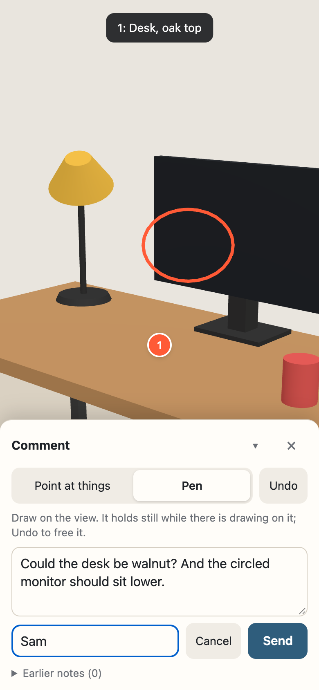
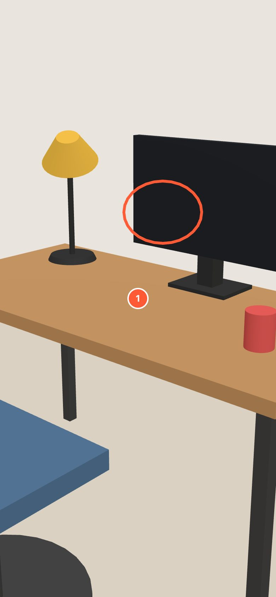
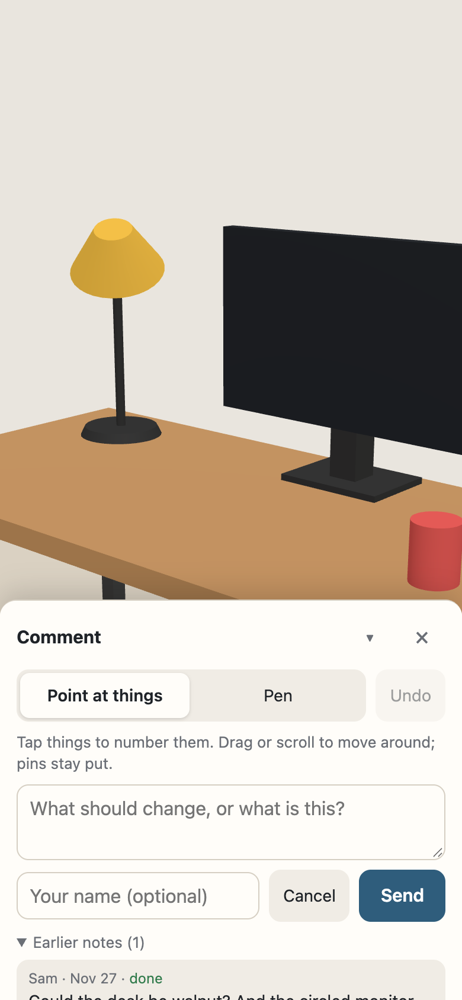
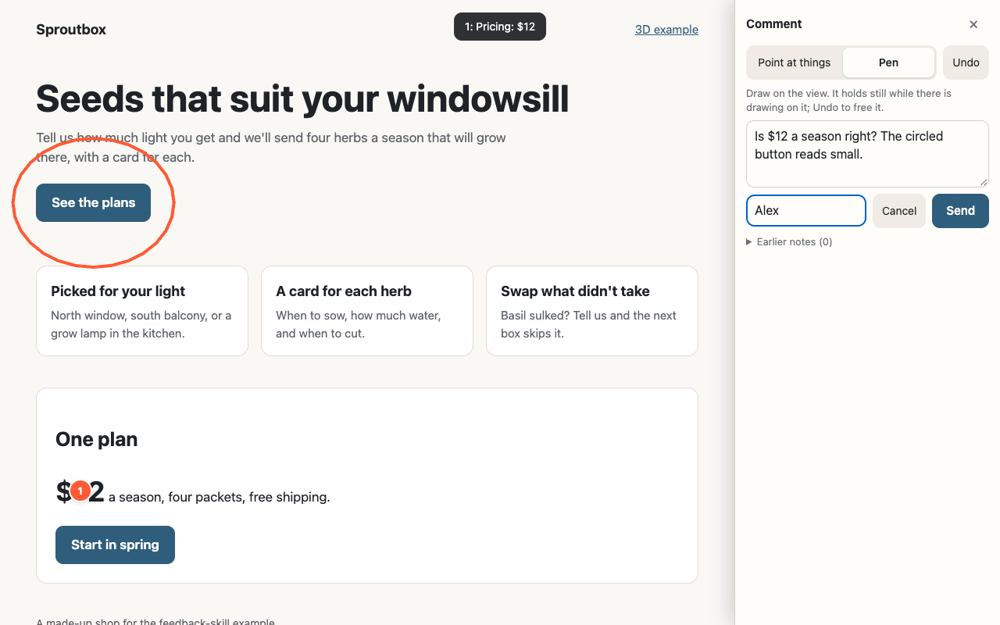
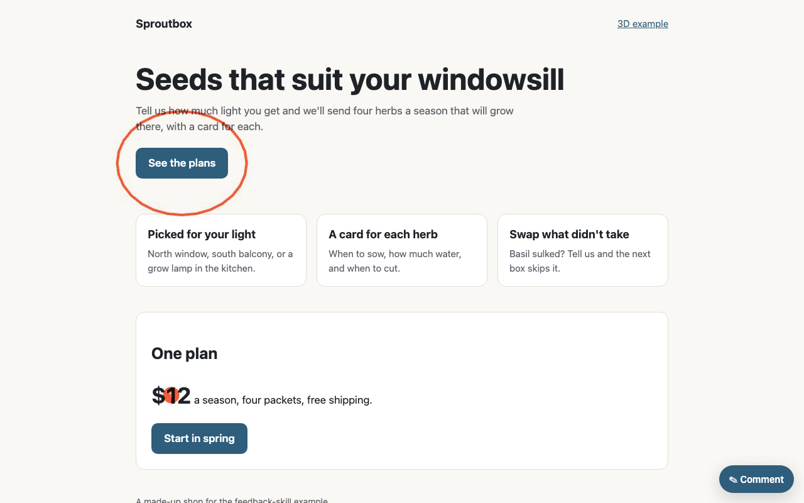
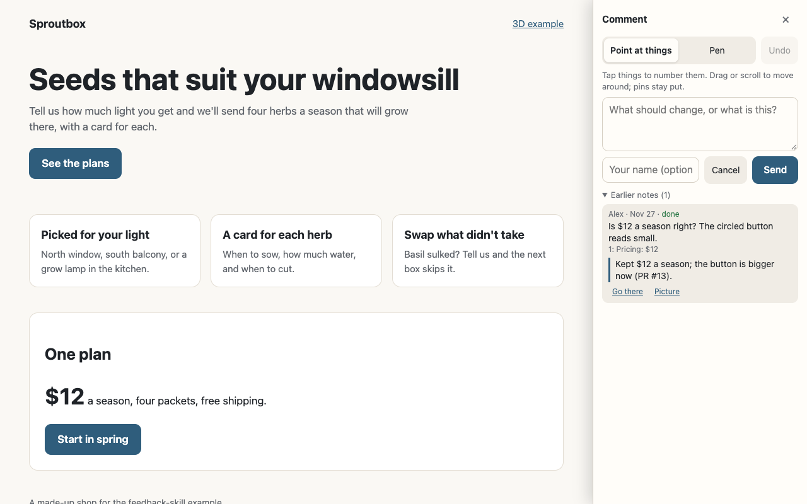

# feedback-skill

A Comment button for any web page that a coding agent answers. Someone taps things to drop
numbered pins, circles things with a pen, writes a note and sends it. A
[Claude Code](https://claude.com/claude-code) session picks the note up, looks at the
picture, makes the change, and replies, and the reply shows under the note on the page.

I built it for a 3D viewer of scanned rooms, so the people the rooms belong to could point at
a shelf and say "that's 2 inches lower in real life" without learning anything. It works the
same on a plain page. This repo is the pattern pulled out on its own: the page script, a
Cloudflare Worker with D1 behind it, the agent's script and hook, and a Claude skill that
walks an agent through the loop.

| Pin and pen, on a phone | What the agent gets | The reply, back on the page |
| --- | --- | --- |
|  |  |  |

On a plain page, a pin lands on the element under the tap (a selector plus the text you
tapped) and follows it if the layout moves:



A page's DOM can't be snapshotted like a WebGL canvas, so a 2D note's picture is the marks on
white. `tools/overlay.py` screenshots the page at the note's viewport and puts the marks back:





## It never blocks the page

The Comment panel docks at the side of the page instead of sitting on it: a right-hand
sidebar (340px) on a wide screen, a bottom sheet of at most 40% of the height on a phone
that folds down to its header. You keep orbiting, scrolling and tapping the page with it
open; that's how pins get dropped. Never turn it into a centred modal. While it's open,
`<body>` has the class `fb-noting`, so a page can move its own right-hand controls out of
the way by `var(--fb-dock-w)`.

## The loop

1. **The person** opens Comment, taps things (numbered pins) or draws (Pen), writes a note,
   Sends. The page posts JSON to `/api/comments`: the note, pins, the view (camera or
   scroll), the viewport, a deep link, and a JPEG of what they saw with the ink and pins
   drawn in (≤1600 px wide).
2. **The Worker** checks it (page whitelist, honeypot, size caps, link origin) and stores a
   row in D1.
3. **A session starts.** A SessionStart hook runs `comments.py --hook`, so Claude opens
   with the open notes in context. Silent when there are none.
4. **The agent** runs `comments.py show ID`, *looks at the picture* (pen marks exist only
   there), finds what the pins point at, makes the change, opens a PR, deploys.
5. **It replies:** `comments.py reply ID "Lowered the shelf 2 in (PR #41)"`. The person
   opens Comment, and under "Earlier notes" the reply sits beside their note, with "Go
   there" (the view they wrote it from) and "Picture".

## Try it locally

Needs [wrangler](https://developers.cloudflare.com/workers/wrangler/), [uv](https://docs.astral.sh/uv/)
and Node. No Cloudflare account for this part.

```
$ make dev                     # local D1 + wrangler dev on http://127.0.0.1:8791
# open it, press Comment, tap the desk, draw, Send
$ make comments                # open notes in the local database
c_mwfwb9by8npr  2026-11-14 04:18Z  desk  [open]
  Sam: Could the desk be walnut? And the circled monitor should sit lower.
  pins: 1 Desk, oak top
  pen: 1 stroke(s), see the picture
$ uv run scripts/comments.py --config example/wrangler.jsonc --local show c_mwfwb9by8npr
$ uv run scripts/comments.py --config example/wrangler.jsonc --local reply c_mwfwb9by8npr "Walnut now (PR #12)."
$ uv run tools/demo.py send    # or let Playwright do the person's part (and the screenshots)
$ make test                    # pytest (comments.py, catalog) + node --test (worker.js)
```

## Put it on your site

1. **D1:** `wrangler d1 create feedback-comments`; put its id and your account id in
   `example/wrangler.jsonc` (the `<your-...>` placeholders), and your site's origin in
   `ALLOWED_ORIGINS`. Then `wrangler d1 migrations apply feedback-comments --remote`.
2. **Worker:** `worker.js` and `rules.js` beside your static files, with
   `"run_worker_first": ["/api/*"]` so only the API runs code. `wrangler deploy`.
3. **Pages:** list them in `pages.json` (the server's whitelist), add `comments.css` and
   `comments.js`, and mount it:

   ```html
   <link rel="stylesheet" href="comments.css">
   <script type="module">
     import { mountComments, domAdapter } from './comments.js';
     mountComments({ page: 'pricing', ...domAdapter() });
   </script>
   ```

   For a three.js scene, pass an adapter instead: `pick` (raycast a tap), `project` (3D
   point to screen), `frame` (render and return the canvas), `view`/`goTo`/`link` (the
   camera), `hold` (stop the orbit while there's ink), and call `tick()` in the render
   loop. The adapter in `example/public/scene.js` is about 25 lines. Put `{id, label}`
   in each piece's glTF extras and pins say what they're on.
4. **Agent:** copy `scripts/comments.py` (standard library; uses your wrangler login, so no
   token in the repo) and add the hook to `.claude/settings.json`
   (`example/.claude/settings.json` is one).

## Signed-in sites

If the page is behind a login, the note should say who wrote it without asking. Behind
[Cloudflare Access](https://developers.cloudflare.com/cloudflare-one/policies/access/):

- set `"AUTHOR_FROM_ACCESS": "1"` in the Worker's `vars`; it then stamps each note with the
  email Access signed in (the `cf-access-authenticated-user-email` header) and ignores any
  typed name, and `GET /api/me` answers `{email}`;
- pass `me: './api/me'` to `mountComments`; the panel shows the email where the name box was.

Trust the header only when Access covers the whole hostname and the `workers.dev` and preview
URLs are off. A stricter site verifies the `Cf-Access-Jwt-Assertion` token itself and passes
the email in.

## The skill

`skills/feedback/SKILL.md` tells an agent how to handle a note (list, show, look, act,
reply), how to add the button to a site, and the lessons, each from something that broke.
To use it with Claude Code:

```
$ ln -s "$PWD/skills/feedback" ~/.claude/skills/feedback
```

Then: "any comments on the site?", "answer the open notes", "add a Comment button to the
pricing page".

## What's in here

| Path | What it does |
| --- | --- |
| `example/public/comments.js`, `comments.css` | the button, the docked panel (right sidebar / phone bottom sheet), pins, pen, picture, earlier notes; `domAdapter()` for plain pages |
| `example/public/index.html`, `scene.js` | a three.js desk with a Comment button |
| `example/public/flat.html` | a plain page with one |
| `example/public/pages.json` | the catalog: the only pages the server takes notes for |
| `example/worker.js`, `rules.js` | `POST /api/comments`, `GET /api/comments?page=`, `GET /api/comments/ID.jpg` |
| `example/migrations/0001_comments.sql` | the D1 table |
| `scripts/comments.py` | list, `show`, `reply`, `--hook`, `--local` |
| `tools/overlay.py` | a 2D note's marks back on a screenshot of the page |
| `tools/demo.py` | drives the example in Playwright and takes these screenshots |
| `tests/` | quoting and config parsing, catalog = whitelist, the worker against a fake D1 |

## Trade-offs

- **Public by default.** No login on the endpoint, and replies are readable by anyone who
  can open the page. Fine for a family or a small team. For anything bigger, put
  Turnstile or Cloudflare Access in front of `/api/*`.
- **Pictures live in D1** as data URLs (up to 1.5 MB each). Simple, and D1's free tier holds
  thousands. Move them to R2 if you expect a lot.
- **2D pictures don't include the page.** Pass your own `frame()` (html2canvas, say) if you
  want them to; otherwise `tools/overlay.py` reconstructs it from the link.

## License

MIT. See [LICENSE](LICENSE). three.js is vendored under its MIT license.
